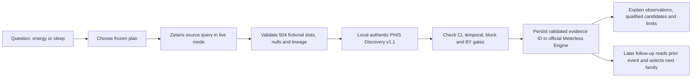

# PHIS versus a prompted general LLM: what this demo actually does

PHIS is a bounded, persistent investigation pipeline for longitudinal fictional health records. The local scientific v2 run asks a question, selects an energy or sleep plan, validates 504 typed slots, runs authentic pre-existing PHIS Discovery v1.1, checks temporal/resampling/multiple-testing gates, persists an evidence event in the official Meterless World Model Engine, and makes a different predeclared analysis available on follow-up. An unsupported or failed step abstains. The v2 route is opt-in; PR #13 remains the default runnable fallback.

**Executed:** local synthetic HTTP → Discovery → Engine and subsequent Engine read changed a generic follow-up from energy to sleep. Bounded Zetaris pagination and fail-closed validation passed injected-transport tests. **Blocked:** real 504-row Zetaris HTTP read, because its local daemon and credentials were unavailable. Thus the diagram's Zetaris live stage is an implementation path, not a verified sponsor proof in this PR. The official Meterless Engine is local durable state; it is not Meterless Runtime/Nightshift inference or NVIDIA Nemotron.

| Question | This PHIS v2 implementation | A general LLM with a data summary |
| --- | --- | --- |
| Where numbers come from | Typed synthetic source rows and deterministic Discovery outputs with source IDs, N, CIs, p/q and plan hashes | Depends on the supplied data and tools; a tool-enabled LLM can also compute statistics |
| Multiple hypotheses and lags | Two predeclared 16-child families with corrected parent/child gates and calendar-preserving lags | Requires an equivalent explicit plan and computational tool to make the same claim |
| Weak evidence | Engine `unstable_candidate` and `insufficient_data` remain unpromoted; this revision yields **no qualified contributor** | Prompt instructions alone do not establish an independent execution record |
| Memory | Official Meterless World Model stores a validated package identity; later read selects the next family | Can be built with a comparable persistent, validated memory design |
| Source failure | Live path refuses local fixture fallback and publishes no stale scientific package | Depends on the particular application implementation |

This is an **architectural comparison**, not an empirical benchmark or a claim that ChatGPT, Claude or another tool-enabled model cannot perform statistics. A fair future comparison would give each system the same fictional records, analysis plan, task prompts and tool access, then score correctness, calibration, provenance and follow-up behavior. No such controlled comparative run was executed here.

## Capability boundary

| Current, evidenced in this branch | Current but blocked here | Roadmap only |
| --- | --- | --- |
| Fictional 84-day records; 504-slot schema; explicit nulls; deterministic energy/sleep Discovery with two frozen plans; official local Meterless persistence/read; opt-in HTTP v2 path; v1 fallback | Live local Zetaris v2 read and sponsor proof; public packaging of private Discovery under owner license/IP gate; a qualified contributor in the revised recent-change scenario | Apple Health/wearables, clinical records, personal contextual diary entry, automatic ingestion, scheduled or 24/7 reanalysis, proactive alerts, validated personal experiments |

Each future source needs explicit consent, minimization, identity and timestamp checks, unit normalization, quality scoring and alignment to local sleep/wake dates before analysis. Later user-entered context such as a late night or alcohol use could become a new **validated observation**, not a retroactive causal label. The aim is testable low-risk hypotheses and questions for a clinician, never diagnosis, prescription or autonomous treatment.

## Frontend handoff contract

`POST /api/investigations` defaults to `investigation.v1`; `{"analysis_version":"v2"}` opts into `investigation.v2`. The existing frontend can use `?analysis=v2` for a scientific local demo while leaving the fallback untouched. The v2 response retains `summary`, `window`, `coverage`, `series`, `comparison`, `findings`, `tool_trace` and `sponsor_proofs`, and adds `scientific_evidence`. That package carries the full 16-child declared family, plan/policy/source digests, source query IDs, exact paired source IDs, r/CI/N/p/q, temporal and block flags, and engine classification. Finding kinds distinguish `observation`, `candidate_contributor`, `unsupported_hypothesis`, `uncertainty` and `abstention`. A failure returns no comparison, series or scientific package. The client rejects an untraced sponsor proof or stale package.

The v2 frontend is a **minimal contract handoff**. Full evidence hierarchy, chart scaling for sleep, English copy review, accessible source drawer and visual polish remain a focused UI work packet. A clean clone can run the PR #13 v1 route; v2 requires the separately approved local Discovery package and will abstain without it.

## 25-second judge narration

“This fictional person’s average energy fell 0.74 points in the latest 28 days. PHIS checked the actual dated records, including missing days, and ran 16 predeclared energy tests with lag, uncertainty and multiple-testing checks. Some raw correlations look strong, but the temporal and robustness gates reject them, so the system will not invent a cause. It stores that verified result in the official World Model; a follow-up reads it and investigates sleep next. Live Zetaris proof and public Discovery packaging are still gated, and the existing release candidate remains available.”
