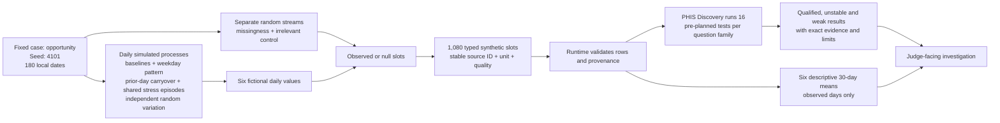

# The fictional 180-day record — judge guide

**This is a reproducible simulation, not a participant record or clinical validation.** The local demo uses the frozen `opportunity` case and predetermined seed `4101`. It covers 25 April–21 October 2026: 180 local calendar days × six typed observation slots = 1,080 slots. A missing measurement keeps its slot with a `null` value; it is never replaced by zero.

## What the generator deliberately puts in the fiction

| Variable | Fictional recording | Simulated structure in the `opportunity` case |
| --- | --- | --- |
| `energy_central` | 1–10 energy diary | Baseline 6.4; same-day sleep and stress terms, prior-day exercise and energy carryover, independent noise. |
| `sleep_hours` | Sleep attributed to waking date | Baseline 7.35 hours; prior-day caffeine and stress terms, prior sleep carryover, independent noise. |
| `stress_score` | 1–9 stress diary | Baseline 3.8, weekday variation, prior stress carryover, and two temporary shared workload episodes. |
| `late_caffeine` | 0/1 diary, after 14:00 local | Probability starts at 0.37 and varies with same-day stress and prior caffeine. |
| `exercise_load` | 0–9.5 fictional activity score | Baseline 3.7, Tuesday/Saturday pattern, prior exercise carryover, independent noise. |
| `unrelated_count` | 0–6 fictional control log | Separate random stream with no designed relation to the other outcomes; a negative control. |

The two temporary workload episodes enter the **stress process** at day indexes 85–103 and 139–152. They are potential shared influences, not instructions to force a particular energy result. Random variation is Gaussian for the continuous processes; source values are clipped to declared bounds and rounded to three decimals. Independent random streams generate missingness and the unrelated control. Missingness is sampled at 5–8% depending on variable, plus a fixed two-day sleep gap. This simulation does **not** model missingness caused by fatigue or stress.

These details describe **known simulation design**, visible in the frozen [generator source](../src/phis_open_agent/stochastic_benchmark.py). They are not independently discovered causal mechanisms for a person. The runtime passes typed observation rows to the [180-day source validator](../src/phis_open_agent/scenario_contract_180d.py); Discovery does not receive the generator equations, its seed, or a privileged answer key.

## What PHIS independently reports from the generated rows

- The [180-day scientific route](../src/phis_open_agent/scientific_180d.py) publishes the complete daily series for the investigated outcome, actual observed-day coverage, and **six fixed 30-day descriptive means** computed from recorded days. A first-to-last difference is descriptive only.
- The [Discovery adapter](../src/phis_open_agent/discovery_adapter_180d.py) runs the frozen family of **16 pre-planned tests** for the selected energy or sleep question. It returns exposure, outcome, lag, effect, sample size, corrected-test and temporal/robustness metadata, classification, and source IDs. Only `candidate_signal` qualifies for the primary supported-association surface. `unstable_candidate` remains exploratory; weak results remain visible in the technical table.
- The exact same-day and next-day tests can receive different classifications. A same-day qualified sleep–energy association does not qualify the next-day hypothesis. Neither result establishes a cause, diagnosis, treatment, or effect in a real person.
- The original two adjacent 28-day means remain in **Recent changes**. They summarize the end of the record and do not replace the full 180-day analysis.

The fixed seed makes the fictional dataset repeatable and auditable. It proves that the software can preserve lineage, execute Discovery, show uncertainty and abstain; it does **not** prove medical usefulness, causal discovery, generalization to real patients, or sponsor connectivity. Source mode and sponsor receipts must be read per run. The methodology and held-out seed reporting are in [the frozen benchmark method](SYNTHETIC_BENCHMARK_METHODOLOGY_2026-10-23.md).
